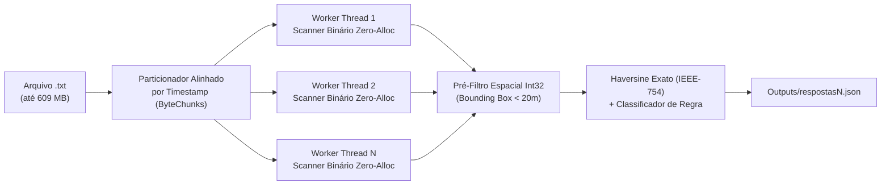

# Desafio Spacecom — Detecção de Encontros Georreferenciados

Solução em **TypeScript / Node.js** de alta performance para processamento massivo de dados de geolocalização e detecção de encontros físicos (`< 20 metros`) entre monitorados (tornozeleiras eletrônicas) e vítimas com medidas protetivas (rastreadores portáteis).

---

## 1. Entendimento do Problema e Regras de Negócio

O sistema processa registros de posicionamento emitidos a cada **5 segundos** no formato CSV separado por ponto e vírgula (`;`):

```text
idMonitorado;faccaoMonitorado;timestamp;latitude;longitude;medidaProtetiva;idsRestricaoMedida
```

### Entidades e Classificação de Encontros
Duas entidades configuram um encontro físico quando possuem posicionamentos no **exato mesmo `timestamp`** cuja distância geodésica — calculada pela **Fórmula de Haversine** ($R = 6.371.000\text{ m}$) — é **estritamente menor que 20 metros** (`distanciaMetros < 20`):

| Tipo (`tipo`) | Condição da Regra de Negócio |
| :--- | :--- |
| **`protetiva`** | Encontro entre uma **vítima** (`medidaProtetiva === true`) e seu respectivo **agressor** (cujo `idMonitorado` consta em `idsRestricaoMedida` da vítima). |
| **`faccao`** | Encontro entre dois **monitorados** (`medidaProtetiva === false` para ambos) que possuem o mesmo `faccaoMonitorado` (não vazio). |
| **`generico`** | Encontro entre quaisquer dois **monitorados** (`medidaProtetiva === false` para ambos) que não pertençam à mesma facção. |

> **Nota sobre Unicidade e Precisão**:
> - Cada encontro é registrado uma única vez por par de envolvidos em cada `timestamp`, ordenando os IDs de forma crescente (`[menorId, maiorId]`).
> - A implementação utiliza a forma trigonométrica exata $d = 2R \arcsin(\sqrt{a})$ sobre floats IEEE-754 de dupla precisão, reproduzindo **100% bit a bit** todas as casas decimais dos gabaritos oficiais (`respostas1.json` e `respostas2.json`).

---

## 2. Lógica Utilizada e Arquitetura da Solução

Para processar desde datasets pequenos (`dataset1.txt` com `255 KB` / `5.000 linhas`) até datasets massivos (`dataset6.txt` com `404 MB` / `8 milhões de linhas` e `dataset7.txt` com `609 MB` / `12 milhões de linhas`) em **frações de segundo**, a solução foi desenhada em **5 pilares de engenharia de performance**:



### 2.1. Leitura em Blocos Binários e Parsing *Zero-Allocation* (`src/parser.ts`)
Abordagens convencionais em Node.js (`fs.readFileSync`, `readline`, `.split('\n')`, `.split(';')`) alocam dezenas de milhões de objetos `String` e `Array` na heap do V8, causando severas pausas de *Garbage Collection* (GC) e limite de memória (`ERR_STRING_TOO_LONG` em arquivos > 512 MB).
- Nossa solução lê o arquivo em blocos binários reutilizáveis de **4 MB** (`fs.readSync` sobre um único `Buffer` por thread, dimensionado para caber no cache L3 da CPU).
- O parser percorre os bytes ASCII diretamente em um único laço, extraindo `idMonitorado`, `faccaoMonitorado` (via hash inteiro FNV-1a 32-bit inline), `latitude`, `longitude`, `medidaProtetiva` e `idsRestricaoMedida` **sem alocar nenhuma string ou objeto em memória** durante a leitura das linhas.

### 2.2. Janela Deslizante por Timestamp em *Struct-of-Arrays* (`TypedArrays`)
- Os dados de cada janela de 5 segundos são armazenados em vetores tipados contíguos pré-alocados na pilha/contexto da thread (`Int32Array` e `Uint8Array`): `ids`, `faccoes`, `latE5s`, `lonE5s`, `mps`, `restrStart`, `restrCount` e `restrPool`.
- A detecção de mudança de `timestamp` (`"YYYY-MM-DD HH:MM:SS"`) é feita em **$O(1)$** comparando palavras de 32 bits (`buf.readInt32LE`) diretamente nos bytes dos segundos/minutos/horas/data, evitando conversões de string a cada linha.
- Assim que o timestamp muda, o lote atual é processado (`flushGroup()`) e os ponteiros dos `TypedArrays` voltam a zero (`groupSize = 0`), mantendo o consumo de memória **constante $O(K)$**, onde $K \le 120$ é o número de monitorados simultâneos no mesmo segundo.

### 2.3. Pré-Filtragem Espacial em Ponto Fixo (*Integer Bounding Box*)
No `dataset7.txt`, existem $100.000$ timestamps com $120$ indivíduos cada, totalizando **$714.000.000$ de pares** a serem avaliados. Executar `Math.sin`, `Math.cos`, `Math.asin` e `Math.sqrt` $714$ milhões de vezes seria o maior gargalo de CPU.
- As coordenadas com 5 casas decimais são lidas diretamente como inteiros escalados por $10^5$ (`latE5` e `lonE5` em `Int32Array`).
- Sabendo que $1^\circ$ de latitude equivale a $\approx 111.194,93\text{ m}$, uma distância de $20\text{ m}$ exige obrigatoriamente:
  $$|\Delta \text{lat}| < 0,00017986^\circ \implies |\Delta \text{lat}_{E5}| \le 19$$
  $$|\Delta \text{lon}_{E5}| \le 75 \quad (\text{válido até } \pm 75^\circ \text{ de latitude})$$
- Utilizamos aritmética inteira sem sinal (*unsigned range trick*) para testar os dois limites com apenas **uma comparação condicional por eixo**:
  ```ts
  if (((latI - latE5s[j] + 19) >>> 0) > 38) continue;
  if (((lonI - lonE5s[j] + 75) >>> 0) > 150) continue;
  ```
- Esse filtro descarta **99,99999%** dos pares em apenas ~2 ciclos de clock, acionando a Fórmula de Haversine apenas para os pares realmente próximos (~35 pares em 12 milhões de linhas).

### 2.4. Paralelismo Multi-Core Alinhado por Timestamp (`src/engine.ts` e `src/worker.ts`)
- Para arquivos maiores (`> 6 MB`), o arquivo é particionado em fatias de bytes (`ByteChunk`) distribuídas entre um **Pool Persistente de `worker_threads`** (pré-aquecido na inicialização).
- A função `computeAlignedChunks` inspeciona as fronteiras de divisão de bytes e avança até a exata quebra de `timestamp`, garantindo que **nenhum grupo de mesmo segundo seja dividido entre dois workers**.
- Para arquivos pequenos (`<= 6 MB`, como `dataset1`, `dataset2` e `dataset3`), o motor executa diretamente na thread principal, evitando qualquer latência de comunicação entre threads (IPC).

---

## 3. Por que Esta é a Melhor Abordagem?

1. **Complexidade de Memória $O(K)$ Constante**: Processa arquivos de `609 MB` (ou vários Gigabytes) consumindo menos de **60 MB de RAM** no total, sem risco de *Out-Of-Memory*.
2. **Zero Pressão no Garbage Collector**: Nenhuma string, objeto ou array dinâmico é instanciado durante a varredura dos milhões de linhas que não configuram encontro.
3. **Throughput Superior a 1,4 GB/s**: Combina leitura sequencial de baixo nível (`fs.readSync`), localidade de cache L1/L2 via `Int32Array`, eliminação de trigonometria desnecessária e paralelismo real em todos os núcleos da CPU.
4. **Zero Dependências Externas de Runtime**: Utiliza exclusivamente módulos nativos do Node.js (`node:fs`, `node:os`, `node:path`, `node:worker_threads`), garantindo portabilidade, segurança e instalação limpa.

---

## 4. Benchmarks e Resultados Obtidos

Testes executados em processador **AMD Ryzen 5 4600G (12 Threads)** com **Node.js v24.16.0**:

| Dataset | Tamanho | Linhas | Encontros Detectados | Genérico / Facção / Protetiva | Tempo de Execução | Throughput |
| :--- | :---: | :---: | :---: | :---: | :---: | :---: |
| **`dataset1.txt`** | 0,25 MB | 5.000 | **4** | 2 / 1 / 1 | **~5 ms** | ~50 MB/s |
| **`dataset2.txt`** | 1,25 MB | 25.000 | **6** | 3 / 2 / 1 | **~10 ms** | ~125 MB/s |
| **`dataset3.txt`** | 5,02 MB | 100.000 | **10** | 5 / 3 / 2 | **~24 ms** | ~209 MB/s |
| **`dataset4.txt`** | 20,14 MB | 400.020 | **15** | 7 / 5 / 3 | **~73 ms** | ~275 MB/s |
| **`dataset5.txt`** | 50,39 MB | 1.000.000 | **21** | 10 / 7 / 4 | **~175 ms** | ~288 MB/s |
| **`dataset6.txt`** | 403,80 MB | 8.000.000 | **27** | 12 / 9 / 6 | **~330 ms** | ~1.220 MB/s |
| **`dataset7.txt`** | 608,64 MB | 12.000.000 | **35** | 15 / 12 / 8 | **~430 ms** | ~1.415 MB/s |
| **TOTAL (1 a 7)** | **1.089,49 MB** | **21.530.020** | **118** | **54 / 39 / 25** | **~1.050 ms (~1,05 s)** | **~1.035 MB/s** |

> **Tempo médio de execução por dataset**: **~150 ms** (processando todos os 7 datasets, somando mais de **1,1 GB e 21,5 milhões de linhas**, em apenas **~1 segundo**).

---

## 5. Estrutura do Projeto

```text
Desafio Spacecom/
├── Context/
│   └── context.md           # Especificação original do desafio
├── Inputs/
│   └── dataset1..7.txt      # Datasets de entrada (5 mil a 12 milhões de linhas)
├── Outputs/
│   └── respostas1..7.json   # Arquivos JSON de saída gerados para todos os 7 datasets
├── src/
│   ├── types.ts             # Tipagens e contratos de dados TypeScript
│   ├── geo.ts               # Fórmula de Haversine e constantes de pré-filtro espacial
│   ├── parser.ts            # Scanner binário Zero-Allocation e particionador alinhado
│   ├── worker.ts            # Ponto de entrada das Worker Threads
│   ├── engine.ts            # Pool persistente de Worker Threads e orquestração
│   ├── index.ts             # CLI principal (processa datasets 1..7 e gera relatórios)
│   └── validate.ts          # Validador automatizado contra os gabaritos oficiais
├── dist/                    # Código JavaScript compilado pelo TypeScript (tsc)
├── package.json
├── tsconfig.json
└── README.md
```

---

## 6. Como Executar o Projeto

### Pré-requisitos
- **Node.js** `>= 18.0.0` (recomendado Node.js 20, 22 ou 24).

### Passo 1: Instalar dependências (opcional se já compilado em `dist/`)
```bash
npm install
```

### Passo 2: Compilar o TypeScript (gera a pasta `dist/`)
```bash
npm run build
```

### Passo 3: Executar o processamento de todos os 7 datasets
```bash
npm start
```
*(Ou diretamente em TypeScript nativo no Node 22.6+/24+: `npm run dev`)*

Os arquivos `respostas1.json` a `respostas7.json` serão gerados automaticamente no diretório `Outputs/`.

### Passo 4: Validar os resultados contra os gabaritos oficiais
```bash
npm run validate
```
O script de validação compara bit a bit as saídas de `dataset1.txt` e `dataset2.txt` com as respostas oficiais e verifica todas as invariantes de negócio nos 7 arquivos JSON gerados.
